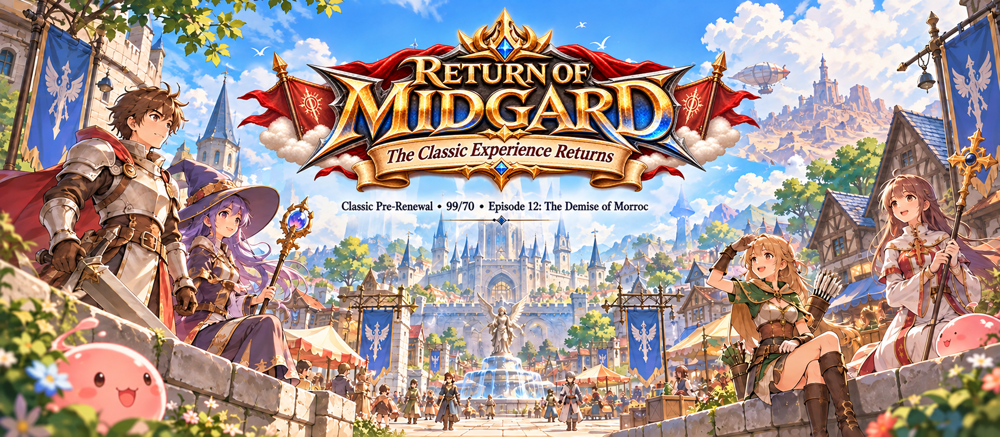

# Return of Midgard Wiki

**The Classic Experience Returns**

**Return of Midgard** was created to bring back the memories and atmosphere of the classic **Philippine Ragnarok Online (pRO)** era, focusing on **Episode 12: The Demise of Morroc**.

Our goal is to recreate the familiar experience remembered by many players from the **Philippine Ragnarok Online (pRO) era** — classic Pre-Renewal gameplay, the 99/70 era, iconic maps, MVP hunting, PvP, War of Emperium, and the adventures that made Rune-Midgard unforgettable.

Return of Midgard is not simply about playing an old version of Ragnarok Online. It is about revisiting the memories, friendships, rivalries, and experiences that made the classic pRO era special.

> **Classic Pre-Renewal • 99/70 • Episode 12: The Demise of Morroc**

## 🔗 Quick Links

- 🌐 [Official Website](https://romidgard.com/home)
- 📝 [Create an Account](https://romidgard.com/home/member/register)
- ⬇️ [Download the Game](https://romidgard.com/home/download) — **PC only; Android and iOS are not supported.**
- 💬 [Join the Discord](https://romidgard.com/discord)
- 📘 [Follow us on Facebook](https://romidgard.com/facebook)

## ✨ New Adventurer?

Start with these guides if you are new to Return of Midgard:

- [Getting Started](getting-started.md) — account creation, client setup, patching, and your first steps in Rune-Midgard.
- [Server Information](server-information.md) — rates, level limits, classes, drop settings, and core gameplay rules.

## 🧭 Explore the Wiki

| Guide | What you'll find |
| --- | --- |
| [NPC & Services](npc-services.md) | Useful NPCs, service locations, requirements, and item needs |
| [Server Features](server-features.md) | Classic client features, PvP, WoE, MVP hunting, rankings, and server systems |
| [Episode 12: The Demise of Morroc](episode-12-the-demise-of-morroc.md) | Episode scope, maps, drops, and classic-era content |
| [MVP & PK Maps](mvp-pk-maps.md) | Current MVP maps where PK is enabled |
| [Premium Account Services](premium-account-services.md) | Premium benefits, activation, and supported services |
| [Claiming Rewards](claiming-rewards.md) | How to claim server and event rewards |

## ⚙️ Server at a Glance

| Setting | Value |
| --- | --- |
| Game Type | Pre-Renewal |
| Supported Platform | **PC only (no mobile support)** |
| Maximum Level | 99/70 |
| Maximum Stat | 99 |
| Maximum ASPD | 190 |
| Instant Cast | 150 DEX |
| Base EXP | x1 |
| Job EXP | x1 |
| Non-MVP Drop Rate | 90% |
| MVP Default Drops | x1 |
| Classes | Transcendent + classic Expanded classes |
| Current Episode | Episode 12: The Demise of Morroc |
| Costume Items | **None — not available** |

## 🎮 Permanently Free-to-Play

Return of Midgard is **permanently free-to-play** and is designed to help players get ready for PvP, War of Emperium, MVP hunting, testing builds, and exploring the classic world without unnecessary preparation.

Players receive **free Zeny**, while in-game shops provide equipment, cards, headgears, potions, consumables, supplies, and other essentials. A **Job Changer NPC** and **Miracle Tonic** are also available to help characters prepare faster.

Premium is an optional account-wide service and is **not required to access the core game**.

## 🔥 Episode 12: The Demise of Morroc

Return of Midgard is centered on the classic **Episode 12** era before Third Jobs and later-generation progression. The playable world focuses on content available up to Episode 12 and the earlier episodes leading into it.

[Read the Episode 12 overview →](episode-12-the-demise-of-morroc.md)

## 📖 About This Wiki

This wiki is the official player reference for **Return of Midgard**. It will continue to expand with guides for classes, maps, dungeons, monsters, MVPs, items, NPCs, PvP, WoE, Premium services, server rules, and other supported systems.

Server mechanics may change as development continues. Important changes will be reflected here and through official server announcements.
