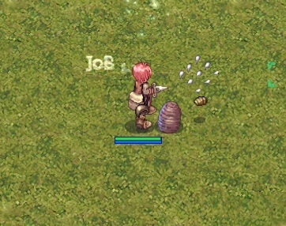
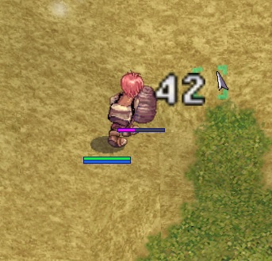

# Classic Client Features

## Monster HP Bar

In classic Ragnarok Online, **monsters do not display a visible HP bar**. Return of Midgard follows this old-style presentation, while some newer clients and private servers show a Monster HP Bar above monsters.

| Old RO — Return of Midgard (No HP Bar) | New UI — Other Servers (With HP Bar) |
| --- | --- |
|  |  |

## Kafra Storage Password

Return of Midgard retains the **classic Kafra Storage Password** system familiar to players from the old **Philippine Ragnarok Online (pRO)** era. This additional password helps protect access to a player's Kafra Storage and preserves a feature that is not commonly seen in many newer private-server clients.

For a general overview of this feature, see [Kafra Storage Password under Server Features](server-features.md#kafra-storage-password).
