# Dye Clothes — Stylist Dinorah Lacostt

**Stylist Dinorah Lacostt** can change your character's clothing color using Clothing Dye Coupons.

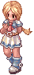

Each supported job class has **three clothing colors** available:

- **Original Dye** — restores the default clothing color
- **Option 1** — alternate clothing color
- **Option 2** — alternate clothing color

## NPC Locations

| NPC | Map | Coordinates |
| --- | --- | --- |
| Stylist Dinorah Lacostt | `in_orcs01` | `20,109` |
| Stylist Dinorah Lacostt | Yuno | `333,108` |
| Stylist Dinorah Lacostt | Comodo | `167,146` |

## Required Items

| Item | Preview | Used For | Where to Get |
| --- | --- | --- | --- |
| **Original Clothing Dye Coupon** |  | Restore your original clothing color | Cash Merchant |
| **New Clothing Dye Coupon** |  | Apply Option 1 or Option 2 | Cash Merchant |

Both coupon types use the same item preview image. Each successful dye change consumes **1 coupon**.

## How It Works

1. Purchase the required Clothing Dye Coupon from the **Cash Merchant**.
2. Talk to **Stylist Dinorah Lacostt**.
3. Choose **Dye clothes.**
4. Select one of the available choices:
   - **Original Dye** — requires 1 Original Clothing Dye Coupon
   - **Option 1** — requires 1 New Clothing Dye Coupon
   - **Option 2** — requires 1 New Clothing Dye Coupon
5. The selected coupon is consumed and your clothing color is changed immediately.

## Dye Options Preview

You can ask Dinorah to preview the available clothing colors before using a coupon.

### Acolyte

| Male | Female |
| --- | --- |
| 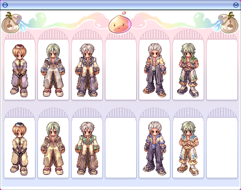 | 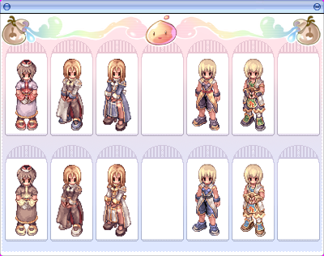 |

### Archer

| Male | Female |
| --- | --- |
| 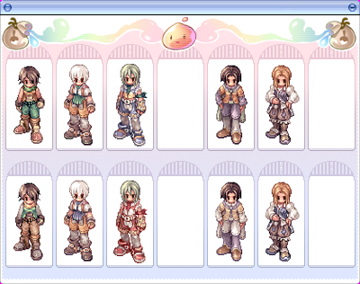 | 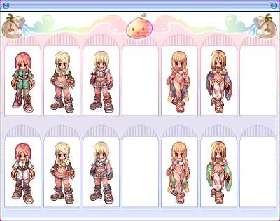 |

### Mage

| Male | Female |
| --- | --- |
| 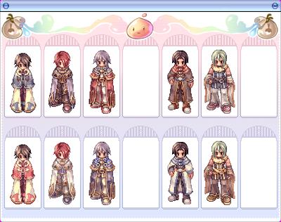 | 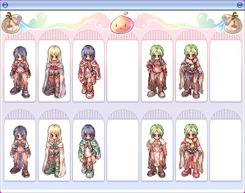 |

### Merchant

| Male | Female |
| --- | --- |
| 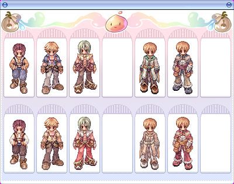 | 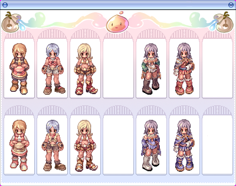 |

### Swordsman

| Male | Female |
| --- | --- |
| 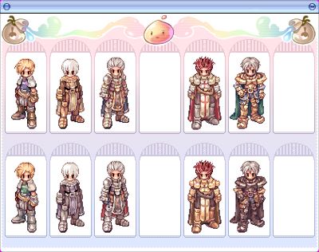 | 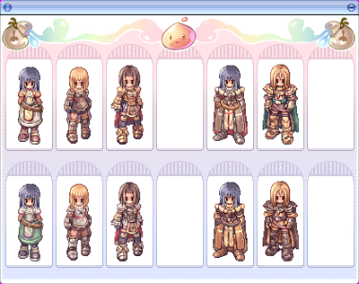 |

### Thief

| Male | Female |
| --- | --- |
| 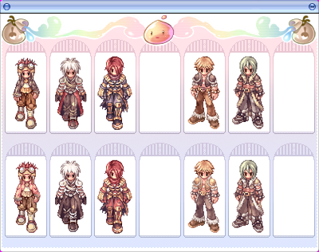 | 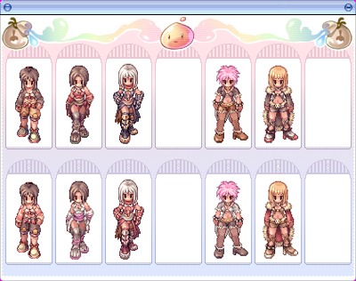 |

### Gunslinger

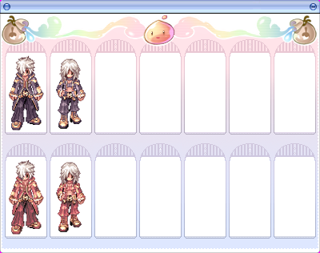

### Ninja

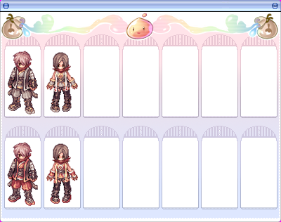

### Other Supported Preview Classes

Dinorah also supports previews for:

- **Novice / Super Novice**
- **Taekwon**

Their preview images can be added here once the corresponding image files are available.

## Important Note After Changing Job

If you change jobs after dyeing your clothes, the client may temporarily display the **original clothing color**.

Simply **relog** and your dyed clothing color should appear again.

## Quick Reference

- **NPC:** Stylist Dinorah Lacostt
- **Available Colors:** Original, Option 1, Option 2
- **Original Color:** 1 Original Clothing Dye Coupon
- **Option 1:** 1 New Clothing Dye Coupon
- **Option 2:** 1 New Clothing Dye Coupon
- **Where to Buy Coupons:** Cash Merchant
- **Supported Preview Classes:** Acolyte, Archer, Mage, Merchant, Novice/Super Novice, Swordsman, Thief, Taekwon, Gunslinger, Ninja
- **After Job Change:** Relog if the original clothing color temporarily appears

Return to [NPC & Services](npc-services.md) for other NPC guides.
