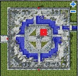

# Mr. Claus — Aldebaran

**A familiar face from the classic Philippine Ragnarok Online (pRO) era.**

Mr. Claus is a Santa-themed NPC featured in **Return of Midgard** as part of the classic pRO-inspired world. If you remember seeing Santa Claus in Ragnarok Online, you can find Mr. Claus in **Aldebaran**.

## NPC Location

| NPC | Town | Coordinates |
| --- | --- | --- |
| **Mr. Claus** | **Aldebaran** | **`168,168`** |

**Map:** `aldebaran`

Travel to Aldebaran and go to **`168,168`** to find Mr. Claus.

### In-Game Location

The image below shows Mr. Claus's location in Aldebaran:

## A Touch of Classic pRO Nostalgia

Return of Midgard brings back familiar characters and details inspired by the original **Philippine Ragnarok Online (pRO)** experience. Mr. Claus is one of those recognizable NPCs that add to the nostalgic atmosphere.

This guide confirms **where to find Mr. Claus**. Any available interactions, event activities, or rewards will be documented separately once their details are confirmed.

For other NPC locations and services, visit [NPC & Services](npc-services.md).
