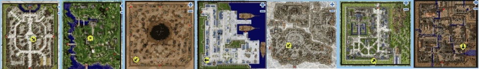

# Refining Guide

**Classic Pre-Renewal Equipment Refining**

Refining improves your equipment by increasing its upgrade level. In **Return of Midgard**, the intended refining success rates follow the familiar classic Pre-Renewal Ragnarok Online system, rather than a custom upgrade-rate system.

This guide covers the required refining materials, safe upgrade limits, normal and enriched success rates, and a map reference for refining NPCs.

## Refining Materials

Each equipment type requires a specific material when using the normal refining system.

| Equipment | Required Material | Safe Upgrade Limit |
| --- | --- | --- |
| **Weapon Level 1** |  **Phracon** | **+7** |
| **Weapon Level 2** |  **Emveretarcon** | **+6** |
| **Weapon Level 3** |  **Oridecon** | **+5** |
| **Weapon Level 4** |  **Oridecon** | **+4** |
| **Armor** |  **Elunium** | **+4** |

A **safe upgrade** has a **100% success rate**. Attempts beyond the safe limit have a chance to fail.

## Normal Refining Success Rates

The table below shows the chance of successfully reaching the listed upgrade level when refining with normal materials.

| Equipment | +1 | +2 | +3 | +4 | +5 | +6 | +7 | +8 | +9 | +10 |
| --- | ---: | ---: | ---: | ---: | ---: | ---: | ---: | ---: | ---: | ---: |
| **Weapon Lv 1** | 100% | 100% | 100% | 100% | 100% | 100% | 100% | 60% | 40% | 19% |
| **Weapon Lv 2** | 100% | 100% | 100% | 100% | 100% | 100% | 60% | 40% | 20% | 19% |
| **Weapon Lv 3** | 100% | 100% | 100% | 100% | 100% | 60% | 50% | 20% | 20% | 19% |
| **Weapon Lv 4** | 100% | 100% | 100% | 100% | 60% | 40% | 40% | 20% | 20% | 9% |
| **Armor** | 100% | 100% | 100% | 100% | 60% | 40% | 40% | 20% | 20% | 9% |

**Example:** Refining a Level 4 weapon from **+4 to +5** has a **60%** success chance. Its safe limit is **+4**.

## Refining with Enriched Ores

Enriched ores offer **higher success rates** than normal ores for certain upgrades from **+1 to +10**. They do **not** make equipment indestructible.

| Equipment | Enriched Material |
| --- | --- |
| **Weapons** |  **Enriched Oridecon** |
| **Armor** |  **Enriched Elunium** |

### Enriched Refining Success Rates

| Equipment | +1 | +2 | +3 | +4 | +5 | +6 | +7 | +8 | +9 | +10 |
| --- | ---: | ---: | ---: | ---: | ---: | ---: | ---: | ---: | ---: | ---: |
| **Weapon Lv 1** | 100% | 100% | 100% | 100% | 100% | 100% | 100% | 90% | 70% | 30% |
| **Weapon Lv 2** | 100% | 100% | 100% | 100% | 100% | 100% | 90% | 70% | 40% | 30% |
| **Weapon Lv 3** | 100% | 100% | 100% | 100% | 100% | 90% | 80% | 40% | 40% | 30% |
| **Weapon Lv 4** | 100% | 100% | 100% | 100% | 90% | 70% | 70% | 40% | 40% | 20% |
| **Armor** | 100% | 100% | 100% | 100% | 90% | 70% | 70% | 40% | 40% | 20% |

**Important:** Enriched refining **can still fail**. When an attempt fails under the classic enriched refining system, **the equipment and any cards slotted into it are destroyed**. Enriched ores increase your chance of success; they do not protect the item from breaking.

**Availability note:** This table documents classic enriched refining rates. The availability of Enriched Ores, supported NPCs, and any required fees should be checked in-game; this page does not confirm that every enriched refining service is currently active.

## Where to Find Refine NPCs

Refining NPCs can be found in several major towns, sometimes inside buildings or separate rooms. Use the location reference below when looking for refinement services.

The map is a **location reference**. Please check the relevant NPC in-game for the currently available services and requirements.

## Important Refining Rules

- **Normal and enriched refining are different methods:** enriched ores improve certain success chances but do not prevent destruction on failure.
- **Safe limits vary:** Weapon Levels 1–4 and armor do not share the same safe upgrade threshold.
- **Beyond the safe limit**, a failed refine destroys the equipment, including cards inserted into it.
- **Success rates apply per attempt**, not to the overall probability of reaching a high upgrade level from +0.
- **Classic scope:** this guide covers upgrades through **+10**. Renewal-era systems for +11 and above are not covered.

## Reference

The success-rate tables and normal refining materials follow the classic reference published by [RateMyServer — Weapon and Armor Refine Success Rates](https://ratemyserver.net/index.php?page=misc_table_refine). Exact in-game NPC availability and operating costs should be verified against the current server implementation.

For other player services, visit [NPC & Services](npc-services.md).
