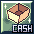

# Simple Cash Shop

Return of Midgard uses the **Simple Cash Shop** interface familiar to players of the old **Philippine Ragnarok Online (pRO)**. It is the classic counterpart of the **Cash Shop** found in newer Ragnarok clients: both serve the purpose of buying Cash Shop items.

In **Return of Midgard**, Cash Shop purchases use **RoK Points**. The main difference highlighted here is the **appearance and layout of the Cash Shop window**, not its purpose.

## Classic pRO-Style Cash Shop

This is the **Simple Cash Shop** interface used in Return of Midgard, preserving the familiar pRO-era design instead of the newer Cash Shop window.

## How to Access the Simple Cash Shop

The **Simple Cash Shop icon** is located in the **upper-right corner of your game screen, near the minimap**.

1. Look for the **Simple Cash Shop icon** near the minimap in the upper-right corner.
2. **Click the icon** to open the Simple Cash Shop.
3. Browse the available items and purchase the ones you want using your **RoK Points**.

You can access the Simple Cash Shop **from anywhere on supported maps**, so you do not have to visit a specific NPC to buy Cash Shop items.

> **Note:** The Simple Cash Shop is **disabled on certain maps**. When you are on one of these maps, the icon **cannot be clicked**, and the Cash Shop cannot be opened there. To use it, move to a map where the Simple Cash Shop is enabled.

### Simple Cash Shop vs Modern Cash Shop

| Return of Midgard | Newer Ragnarok Clients |
| --- | --- |
| Classic **Simple Cash Shop** interface inspired by old pRO | Newer **Cash Shop** interface |
| Purchases use **RoK Points** | Cash Shop currency depends on the server |
| Traditional, simpler window design | More modern window design |

**Important:** The Simple Cash Shop is **not** a separate NPC Item Shop. Regular NPC shops, where players can buy equipment and supplies with Zeny, are different from the Cash Shop.

For a general overview, see [Server Features](server-features.md#simple-cash-shop).
